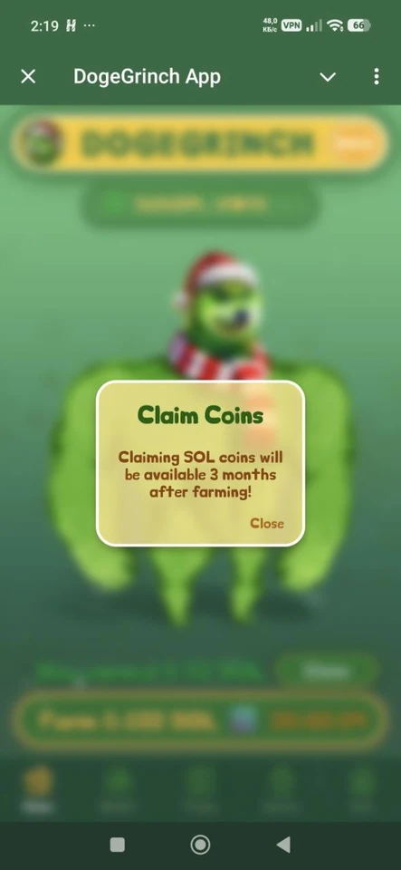

# DogeGrinch - игра в Telegram

Автор проекта - **Евгений Толмачев**. [Профиль GitHub](https://github.com/EvgenyET) · [Проект в портфолио](https://evgeny-dev.pro/project/DogeGrinch_app/dogegrinch_app.html)

Telegram Mini App с фармингом по таймеру, игровым балансом и привязкой Solana-адреса. Клиент на JavaScript, сервер на Express и MySQL.

## Задача проекта

Проект объединяет интерфейс игрового цикла, Telegram WebView и серверное хранение профиля. Для пользователя важно видеть одно и то же состояние таймера и баланса после переходов между разделами и повторного входа.

## Мой вклад

Разработал оформление и клиентскую логику мини-приложения, состояния кнопки фарминга и обратный отсчёт. Связал интерфейс с Express API и MySQL, реализовал экран привязки Solana-адреса, навигацию, уведомления и модальные окна.

## Интерфейс

| Главный экран игры и запуск фарминга | Получение награды в интерфейсе игры |
|:---:|:---:|
|  |  |

## Как работает приложение

DogeGrinch переносит персонажа и визуальный стиль проекта в игровое мини-приложение Telegram. На главном экране пользователь запускает фарминг и видит время до завершения цикла. Состояние профиля и баланс загружаются с сервера. Нижняя навигация ведёт к заданиям, приглашениям и привязке Solana-адреса. Кнопка Claim открывает условия получения награды.

## Возможности

- Запуск фарминга и обратный отсчёт до завершения игрового цикла.
- Загрузка баланса и состояния фарминга из серверного профиля.
- Экраны заданий и приглашений внутри Telegram.
- Привязка и отвязка Solana-адреса с проверкой формата.
- Модальное окно с условиями получения награды и визуальной обратной связью.

## Техническое устройство

### Игровой цикл

Клиент запрашивает состояние фарминга, выбирает доступное действие и обновляет обратный отсчёт. Обработчик Claim открывает информационное модальное окно с условиями вывода награды.

### Разделы игры

Задания, приглашения и кошелёк открываются внутри Telegram. В разделе кошелька форма проверяет формат введённого Solana-адреса и показывает результат привязки.

### Сохранение

Express обрабатывает игровые запросы и обращается к MySQL. От состояния профиля зависят показанный баланс, прогресс и адрес при следующем запуске игры.

## Технологии

| Технология | Роль в проекте |
| --- | --- |
| Telegram Web App | Запуск игры внутри мессенджера. |
| JavaScript и Webpack | Логика экранов и сборка клиента. |
| Express и MySQL | Серверные операции с профилем игрока. |

## Состояние показанной версии

- В рассмотренной версии Claim открывает информационное окно об условиях вывода. Фактическая выплата криптовалюты этим обработчиком не выполняется.

## Демонстрация

На странице портфолио доступны описание, галерея и видеодемонстрация проекта. [Открыть DogeGrinch - игра в Telegram](https://evgeny-dev.pro/project/DogeGrinch_app/dogegrinch_app.html).
