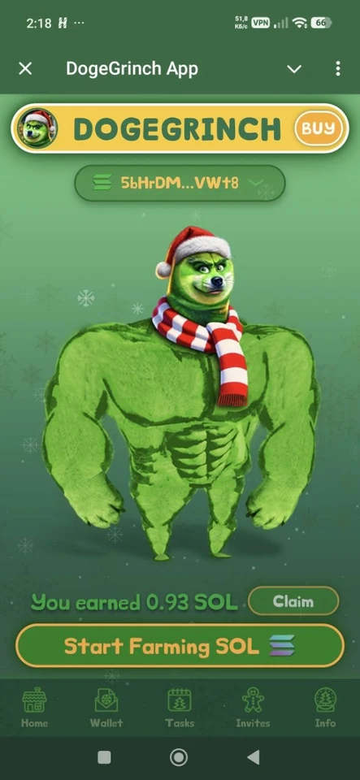

# DogeGrinch - игра в Telegram

**Автор проекта:** [Евгений Толмачев](https://github.com/EvgenyET) · [Страница проекта в портфолио](https://evgeny-dev.pro/project/DogeGrinch_app/dogegrinch_app.html)

Мини-приложение с фармингом, наградами, приглашениями и привязкой адреса Solana.

## Мой вклад

Отвечал за фронтенд и дизайн игры. Нарисовал интерфейс вокруг персонажа DogeGrinch, сделал экран фарминга и получение награды, а также переходы к заданиям и приглашениям. Связал состояния этих экранов с ответами сервера.

## Интерфейс

| Главный экран игры и запуск фарминга | Получение награды в интерфейсе игры |
|:---:|:---:|
|  |  |

## Как это работает

В Telegram игрок запускает фарминг, возвращается за наградой и проверяет задания и приглашения. В кошельке можно указать Solana-адрес, связанный с игровым профилем.

## Возможности

- Фарминг и получение накопленной награды.
- Экраны заданий и приглашений.
- Привязка и отвязка Solana-адреса.

## Технологии

Telegram Mini Apps, JavaScript (ES6), Webpack 5, Babel, SASS/CSS, Node.js, Express, MySQL, REST API, CORS, node-cron, UI/UX, Design.
